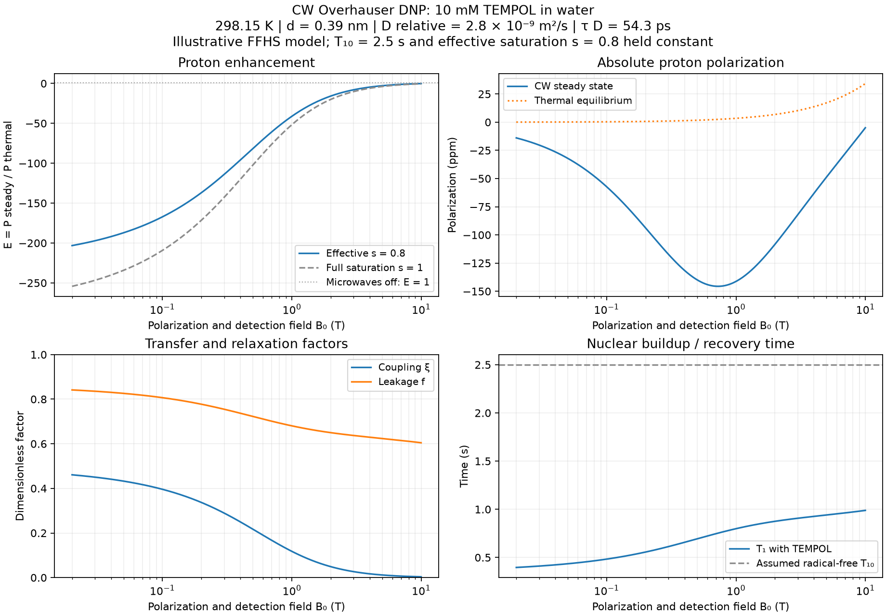

# Liquid-state CW Overhauser DNP

`spin_dynamics.dnp` predicts nuclear polarization in a homogeneous liquid with
prescribed CW electron saturation. It supports measured factors, measured
relaxivities or T1 values, and absolute dipolar rates from force-free hard-sphere
(FFHS) translational diffusion. Scalar self/cross rates can be added explicitly.
Use `spin_dynamics.workflows.dnp` for field/power grids.

The first implementation assumes S=1/2 electrons, positive-gamma spin-1/2 nuclei,
the weak-coupling Zeeman limit, and high temperature. It does not solve nitrogen
hyperfine population mixing, electron dynamics, zero-field pumping, restricted
diffusion, or spin transport. Electron/nuclear gyromagnetic ratios are positive
magnitudes in Hz/T; spectral frequencies are radians/second. Default gammas are
the free electron and proton. No new runtime dependency beyond NumPy is required;
the independent integral audit uses optional SciPy, and plotting uses Matplotlib.

## Start from molecular motion

```python
from spin_dynamics.dnp import (
    TranslationalDiffusionModel, translational_relaxation_rates,
    cw_overhauser, polarization_buildup,
)

motion = TranslationalDiffusionModel(
    closest_approach_m=0.3e-9,
    relative_diffusion_m2_per_s=3e-9,
)
rates = translational_relaxation_rates(
    0.35, motion, concentration_molar=0.001,
    background_r1_per_second=1 / 2.5,
)
cw = cw_overhauser(
    rates, field_tesla=0.35, temperature_kelvin=298.15,
    saturation_factor=0.8,
)
trajectory = polarization_buildup(cw, [0, 0.5, 1, 5, 10])
recovery = polarization_buildup(cw, [0, 0.5, 1, 5, 10], pumping=False)
print(cw.enhancement, cw.coupling_factor, cw.leakage_factor)
```

These illustrative inputs give tau_D=30 ps, xi=0.340477, f=0.299697,
E approximately -52.73 at s=0.8, and T1=1.751 s. Concentration is mol/L,
not mM; relative diffusion is the sum of solvent and radical diffusivities.
The closest approach is an effective electron–nucleus exclusion distance.
These are model parameters, not a universal TEMPOL/water calibration.

Results expose enhancement, absolute thermal and steady polarization, xi/f/s,
field, temperature, all three relaxation rates, T1, spectral model, and
assumptions. Scalars yield zero-dimensional NumPy arrays; condition arrays
broadcast. Buildup results have a leading time axis: `(n_times, *conditions)`.

## Enhancement, relaxation and signs

The baseline-inclusive enhancement is

\[
E=1-\xi f s|\gamma_e|/\gamma_n,\qquad
\xi=R_\sigma/R_\rho,\qquad
f=R_\rho/(R_{10}+R_\rho).
\]

All rates have units s^-1. `R_10` is background relaxation without radicals;
`R_rho` is electron-induced nuclear self-relaxation and `R_sigma` is signed
cross-relaxation. Positive cross-relaxation produces inverted enhancement for
positive-gamma nuclei. Zero microwaves, zero radical contribution, or zero cross
rate gives E=1. Zero self rate defines xi=0; zero total rate gives T1=infinity
and holds the initial polarization during propagation.

For pure dipolar extreme narrowing xi=1/2; for pure scalar transfer xi=-1.
An optional `scalar_self_rate_per_second=q` contributes +q to self and -q to
cross relaxation. Add rates before calculating xi. Never average coupling
factors without their self-rate weights. Saturation and leakage lie in [0,1].
Rate inputs enforce `abs(R_sigma) <= R_rho`.

Thermal polarization is `h*gamma_n*B/(2*k*T)`, consistent with the linear
high-temperature enhancement equation. The API rejects electron thermal
arguments `h*gamma_e*B/(2*k*T)>0.1` (maximum linearization error about 0.33%)
and rejects zero/negative fields, nonfinite inputs, and negative-gamma nuclei.
The field must also be large enough for the assumed Zeeman basis relative to
the actual hyperfine interaction; that cannot be inferred from diffusion alone.
No polarization clipping is used. A nonlinear finite-temperature population
solver is needed outside these assumptions.

## Translational spectral density and absolute prefactor

The FFHS model has uniform density outside r=d and a reflecting boundary at d.
With `tau_D=d^2/D_relative`, use the **one-sided normalized-correlation** spectrum

\[
J(\omega)=\frac{4\tau_D}{9}\mathrm{Re}
\frac{1+z/4}{1+z+4z^2/9+z^3/9},\qquad
z=\sqrt{i|\omega|\tau_D}.
\]

It has units seconds, `J(0)=4*tau_D/9`, and high-frequency limit
`J(omega) ~ 9/(omega^2*tau_D)`. The implementation uses a real rational
expression to avoid cancellation. The integral correlation time is 4*tau_D/9,
not tau_D. `rotational_spectral_density` instead supplies
`tau_c/(1+(omega*tau_c)^2)` for a fixed-length exponentially decorrelating vector.
The existing shared `relaxation.spectral_density_lorentzian` is twice this
one-sided rotational convention; do not interchange prefactors.

For one electron spin 1/2, let `b0=(mu0/4pi)*hbar*gamma_n*gamma_e` with
**angular** gammas. The exterior spatial variance is

\[
V=\int_d^\infty 4\pi n r^2 r^{-6}\,dr=\frac{4\pi n}{3d^3},
\quad n=1000N_A C,\quad A=b_0^2V/10.
\]

Then `R_rho=A*(6*J_minus+3*J_n+J_plus)` and
`R_sigma=A*(6*J_minus-J_plus)`, with the three frequencies
`omega_e-omega_n`, `omega_n`, and `omega_e+omega_n`. The 1/10 coefficient
includes the S=1/2 spin factor and this one-sided convention. For example,
the angular dipolar factors of the nuclear SQ, electron–nuclear ZQ and DQ
Hamiltonian matrix elements give the familiar 3:1:6 rate weights. Density and
spin variance are excluded from J and included once in A.

With positive frequency magnitudes, `H_Z=+omega_e*S_z-omega_n*I_z`:
the DQ spin transition samples the difference frequency and the ZQ transition
samples the sum. A direct angular average of the dipolar Hamiltonian verifies
this assignment and the absolute spin prefactor. Formulas written with signed
electron Larmor frequencies must be converted before comparing terms.

This converts Hwang–Freed's two-sided, density-inclusive expression explicitly:
their Table I quantity `J_two_sided(0)*d*D/(2*n)=4/27`; our normalized
`J_one_sided(0)/tau_D=4/9`. The zero-frequency spatial/time normalization is
also checked from the exterior diffusion Poisson equation with Neumann boundary
condition. The finite-frequency audit integrates the original diffusion
eigenmodes in their Eq. A6, independently of the rational implementation.

## Measured rates, heating and saturation

```python
from spin_dynamics.dnp import OverhauserRates, cw_overhauser, power_saturation

# Each row is a measured condition at its own microwave power/temperature.
# T1 includes radicals; T10 is a matched-condition radical-free reference.
rates = OverhauserRates.from_t1(
    t1_seconds=[1.0, 1.5], t10_seconds=[2.0, 3.0], coupling_factor=0.27,
)
s = power_saturation([0, 1], half_saturation_power_watts=0.3, maximum=0.8)
cw = cw_overhauser(rates, field_tesla=0.35, saturation_factor=s,
                   temperature_kelvin=[298, 310])
```

`OverhauserRates.from_relaxivities` scales self/cross relaxivities in s^-1 M^-1
by concentration in M. `overhauser_from_factors` is a separate path accepting
xi/f/s and finite nuclear T1. Inputs are keyword based and measured and
microscopic paths are separate to avoid conflicting parameterizations.

Saturation is an experimentally supplied effective quantity. The empirical
power model is `s_max*p/(p+p_half)`. `bloch_saturation` supplies the homogeneous
single-line expression with rotating-frame nutation frequency and optional
detuning. Neither predicts redistribution among nitroxide nitrogen hyperfine
lines. Use calibrated effective saturation or s_max; unity is not an automatic
consequence of saturating the observed EPR line.

Temperature does not automatically change diffusivity, background relaxation
or saturation. Supply measured arrays or rebuild the motion model for each
condition. Microwave heating affects both thermal polarization and relaxation;
using microwave-off T1 in all conditions can bias transfer estimates.

Pumping/recovery is `P_target+(P_initial-P_target)*exp(-R1*t)`. The default
recovery T1 includes radicals, not the radical-free T10. For a different
microwave-off rate, use `off_t1_seconds`; for a different off-state temperature,
construct a separate off-state `cw_overhauser` result and recover from the
previous pumped polarization. `cw.to_nano_mr_model()` adapts a scalar condition
to the existing nano-MR helper; grids and infinite T1 are rejected.

Absolute polarization must be propagated if detection and polarization fields
differ. Without relaxation and at common temperature, detection enhancement is
approximately `E_polarize*B_polarize/B_detect`. Transport/field-switch dynamics
and receiver sensitivity gains are not included in this CW API.

## Sweeps, examples and validation

For a concrete TEMPOL/water scenario versus field, run:

```bash
python examples/plot_overhauser_tempol_water.py --output .tmp/tempol_water.png --csv .tmp/tempol_water.csv
```



This example uses 10 mM TEMPOL at 298.15 K, closest approach 0.39 nm,
relative diffusion 2.8e-9 m²/s (tau_D=54.3 ps), radical-free T10=2.5 s, and
effective saturation s=0.8. These are representative modeling assumptions,
not a fit to measured TEMPOL data. Saturation, diffusivity and T10 are held
constant across the field sweep, with the electron irradiation retuned to
resonance at every field. The figure shows enhancement, absolute polarization,
coupling/leakage factors and nuclear T1 from 0.02 to 10 T. Polarization and
detection use the same field. The dashed s=1 curve is a saturation limit.
The CSV exports the underlying rates and observables. Override parameters
with the CLI options listed by `--help`.

TEMPOL/water field-dependent DNP experiments are described in
[Field Dependent Dynamic Nuclear Polarization with Radicals in Aqueous Solution](https://doi.org/10.1021/ja0783207).
The bulk-water diffusion-time scale is discussed by
[Franck et al.](https://doi.org/10.1016/j.pnmrs.2013.06.001).

Run from `PythonSpinDynamics`:

```bash
python examples/plot_overhauser_dnp.py --output .tmp/overhauser_dnp.png
python -m unittest tests.test_overhauser_dnp tests.test_dnp_spectral
python validation/validate_overhauser_diffusion.py
```

The example renders enhancement/polarization versus power, buildup/recovery,
and diffusion-dependent field dispersion. CLI inputs select concentration,
closest approach, relative diffusion and maximum saturation. The workflow
`run_overhauser_power_sweep` returns power rows and field columns.

Validation covers zero-transfer degeneracies; scalar/dipolar limits and
cancellation; leakage/concentration scaling; saturation/detuning; measured
heating-dependent conditions; temporal propagation; and independent numerical
spatial, Poisson, and diffusion-eigenmode integrals. A 12-condition theoretical
reference is stored with provenance in
`validation/experimental/overhauser_ffhs_reference.json`. Despite that directory
name, these are **theory reference values**, not measured observations.
At 0.35 T and tau_D=54 ps the FFHS curve gives xi=0.269402658, consistent with
the approximate 0.27 bulk-water scale discussed by Franck et al.; the diffusion
time is a model input and this is not an independent experimental prediction.
No experimental enhancement-versus-power fit is claimed.

Primary references:

- [Hwang and Freed (1975), JCP 63, 4017, Appendix A and Table I](https://www.acert.cornell.edu/PDFs/JChemPhys63_4017_1975.pdf).
- [Solomon (1955), Physical Review 99, 559](https://doi.org/10.1103/PhysRev.99.559).
- [Türke and Bennati (2011), effective nitroxide saturation](https://doi.org/10.1039/C0CP02126A).
- [Keller and Maly (2021), liquid-state CW ODNP spectroscopy](https://mr.copernicus.org/articles/2/117/2021/).

The quantitative heating/relaxometry framework is described in
[Franck et al. (2013)](https://doi.org/10.1016/j.pnmrs.2013.06.001).
