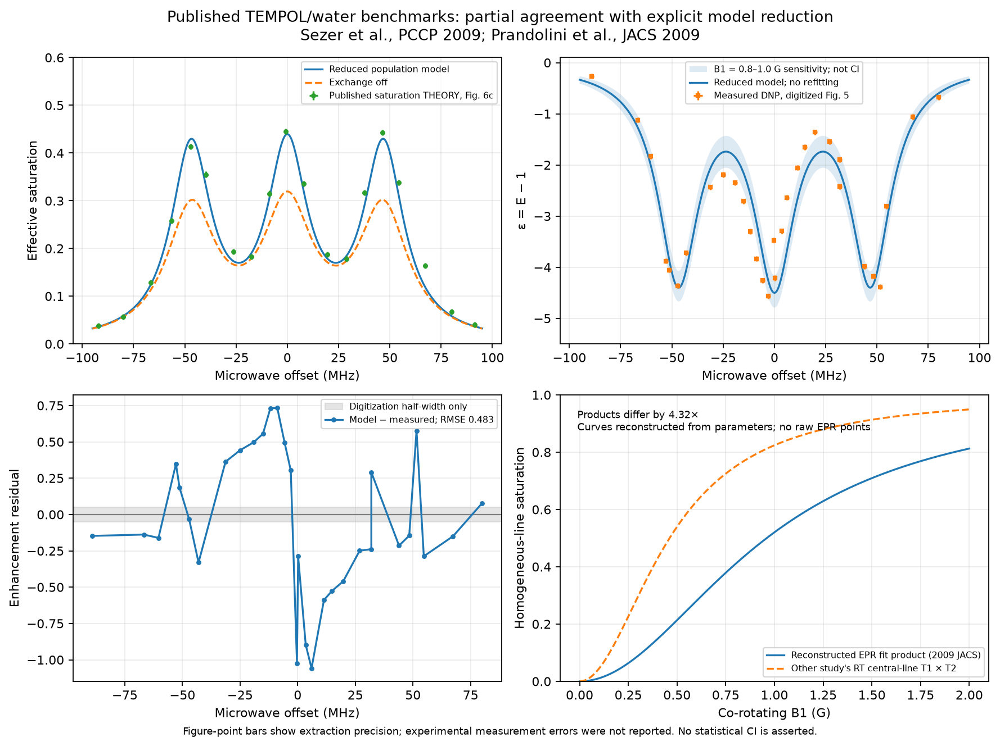
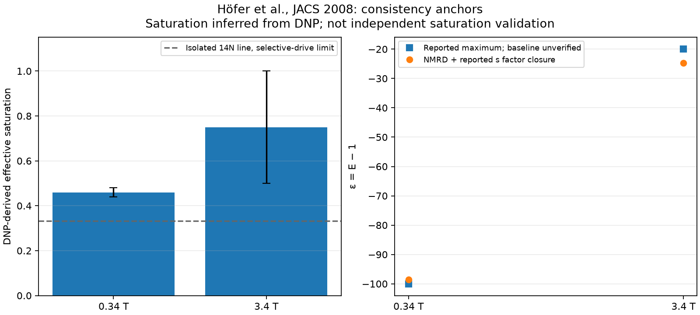
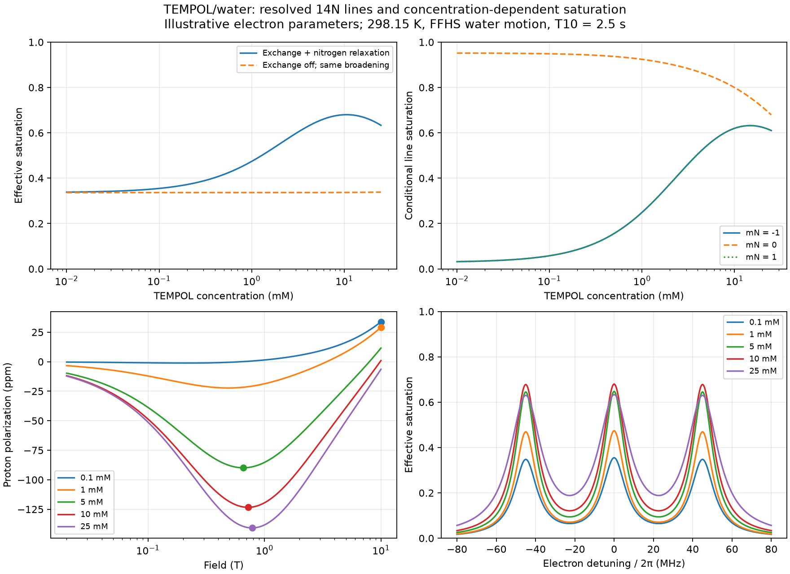
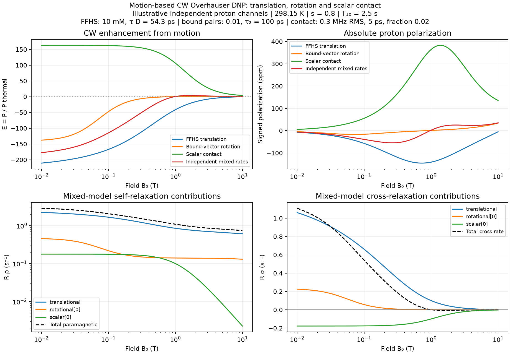
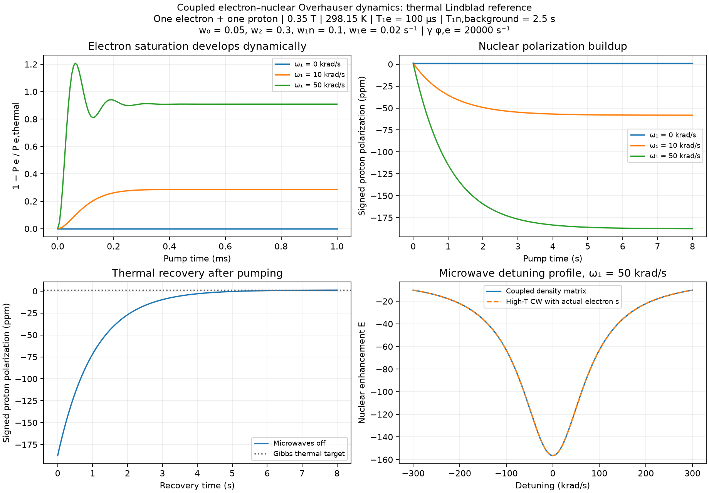

# Liquid-state CW Overhauser DNP

`spin_dynamics.dnp` predicts nuclear polarization in a homogeneous liquid with
prescribed CW electron saturation. It supports measured factors, measured
relaxivities or T1 values, absolute dipolar rates from force-free hard-sphere
(FFHS) translation or bound-vector rotation, and fluctuating scalar contact.
Independent motion channels or supplied scalar self/cross rates can be combined.
Use `spin_dynamics.workflows.dnp` for field/power grids.
A separate `CoupledElectronNuclearModel` resolves microwave driving and thermal
recovery of one electron–nucleus pair, including the electron saturation dynamics.
`NitroxideSaturationModel` supplies ensemble saturation from resolved nitrogen
hyperfine populations, nitrogen relaxation and concentration-dependent exchange.

The first implementation assumes S=1/2 electrons, positive-gamma spin-1/2 nuclei,
the weak-coupling Zeeman limit, and high temperature. Zero-field pumping,
restricted diffusion and spin transport require additional models.
Electron/nuclear gyromagnetic ratios are positive
magnitudes in Hz/T; spectral frequencies are radians/second. Default gammas are
the free electron and proton. No new runtime dependency beyond NumPy is required;
the independent integral audit uses optional SciPy, and plotting uses Matplotlib.

## Concentration-dependent nitroxide saturation

Published TEMPOL/water comparisons now have an [offline benchmark and extraction
audit](tempol_published_benchmarks.md). The unfitted reduced
model has enhancement RMSE 0.483 against extracted experimental markers and
saturation RMSE 0.0175 against a published theoretical profile. This is partial
empirical agreement; independent experimental saturation validation remains
limited by the available calibration metadata.





Run `python examples/plot_tempol_published_benchmarks.py --output .tmp/comparison.png`
for both plots, or `python validation/validate_tempol_water.py` for a JSON report.

`NitroxideSaturationModel` tracks six populations for 14N (S=1/2, I=1),
or four for 15N (`nitrogen_spin=0.5`). It returns each line's conditional
electron polarization and saturation, nitrogen populations, and the effective
saturation averaged over all nitrogen manifolds. A strongly saturated single
line gives effective saturation near 1/3 for 14N or 1/2 for 15N when the other
lines remain unperturbed. Nitrogen relaxation and Heisenberg exchange transfer
the saturation to the other lines.

```python
from spin_dynamics.dnp import NitroxideSaturationModel

nitroxide = NitroxideSaturationModel(
    hyperfine_hz=45e6, electron_t1_seconds=0.5e-6,
    electron_t2_seconds=0.1e-6,
    nitrogen_transition_per_second=1e4,
    exchange_coefficient_per_molar_second=2e9,
    transverse_broadening_per_molar_second=1e9,
)
sat = nitroxide.steady_state(
    field_tesla=0.35, concentration_molar=0.005,
    nutation_rad_per_s=20e6, detuning_rad_per_s=0,
)
# Pass sat.saturation_factor into cw_overhauser with the same conditions.
print(sat.saturation_factor, sat.nitrogen_populations, sat.populations)
```

These electron parameters are **illustrative supplied inputs**, not a measured
TEMPOL calibration. The positive hyperfine spacing is in Hz; detuning and
co-rotating nutation are angular frequencies. Detuning is electron resonance
minus microwave frequency, with line offsets `Delta_m=Delta+2*pi*A*m`.
`nitrogen_transition_per_second` is the symmetric adjacent-m transition rate
per direction, not a nitrogen T1. Nitrogen projections label the penultimate
population axis; the last axis is electron (+1/2, -1/2). Experimental inputs
broadcast, with these two state axes appended.

For a joint population `p[m,e]`, random electron-swap collisions give

\[
\dot p_{me}|_{ex}=k_{ex}(p_m p_e-p_{me}),\quad
k_{ex}=K_{ex} C.
\]

Each pair collision exchanges opposite electron orientations between radicals
with different nitrogen states. This preserves both nitrogen marginals and
total electron magnetization. Our `K_ex` has units M^-1 s^-1, and `k_ex` is the
population-correlation decay rate; literature encounter/transition rates can
use different factors. For uniform nitrogen, writing `x_m` for conditional
electron polarization gives the linear steady balance

\[
0=R_e(P_e^0-x_m)-2W_m x_m
-w_N(Lx)_m-k_{ex}(x_m-\bar x),\qquad
W_m=\frac{\Omega_1^2 T_{2e}}{2(1+\Delta_m^2 T_{2e}^2)}.
\]

Here `R_e=1/T1e` and `L` is the nearest-neighbor nitrogen graph Laplacian.
The effective saturation is `1-mean(x)/Pe0`. The solver works directly with
saturation, giving exactly zero at zero drive. `population_derivative` also
evaluates the full nonlinear population equation for arbitrary normalized
nitrogen populations; `steady_state` specifies the uniform-nitrogen sector.
If nitrogen relaxation is zero, other nitrogen marginals remain invariant.

The thermal reference is factorized: exact electron Boltzmann polarization
`tanh(h*gamma_e*B/(2*k*T))` and uniform nitrogen. Nitrogen Zeeman and hyperfine
Boltzmann corrections are neglected. This is a high-temperature resolved-line
population approximation, distinct from the finite-temperature Gibbs pair
solver below. The API requires electron argument <=0.1 and electron Zeeman
frequency >=10*A*I; these checks do not establish spectral resolution. Use
exchange rates, linewidths and nutation well below the hyperfine angular
splitting. Coherence transfer, exchange narrowing/coalescence, quadrupolar
coherences and coherent transients are outside this model.

Concentration broadening is separately supplied as
`1/T2e(C)=1/T2e(0)+b*C`. It must include the appropriate measured transverse
effects; the population collision coefficient alone does not establish `b`.
Thus increasing concentration can improve line mixing while broadening lowers
central-line saturation at fixed microwave amplitude. No universal exchange
coefficient or field-dependent T1e/T2e is inferred from the TEMPOL name.

The population-swap mechanism and nitrogen-relaxation pathways are described
in [Enkin et al. (2015), including the supporting derivation](https://doi.org/10.1039/C5CP00935A).
[Türke and Bennati (2011)](https://doi.org/10.1039/C0CP02126A) measure effective
saturation by ELDOR for 15N TEMPONE-D; their fitted concentration coefficient
is not assigned to 14N TEMPOL here.

Run the new example:

```bash
python examples/plot_overhauser_tempol_saturation.py \
  --output .tmp/tempol_saturation.png --csv .tmp/tempol_saturation.csv
python -m unittest tests.test_nitroxide_saturation
```



The example compares exchange on/off, individual nitrogen lines, detuning,
and FFHS proton polarization versus field. Microwaves are retuned to the
central line at each field, with electron parameters held constant. CSV
output includes saturation and field curves plus a sibling `_optima.csv`.
Markers maximize **absolute total proton polarization** in 0.02–10 T:

| TEMPOL (mM) | Effective saturation | Field (T) | Signed polarization (ppm) |
| --- | --- | --- | --- |
| 0.1 | 0.354827 | 10.000, boundary | +33.835 |
| 1 | 0.474032 | 10.000, boundary | +29.170 |
| 5 | 0.647356 | 0.657070 | -89.873 |
| 10 | 0.679834 | 0.722151 | -123.346 |
| 25 | 0.633226 | 0.782112 | -140.790 |

The boundary optima are predominantly thermal polarization. These maxima
depend on the supplied rates and bounded field interval; they are not measured
optimal TEMPOL operating conditions. Diffusion, viscosity and temperature are
also held fixed. Tests cover Bloch parity, selective-line limits, analytic
exchange transfer, fast mixing, independent collision enumeration and numerical
population integration. No experimental saturation fit is claimed.

## Start from molecular motion

```python
from spin_dynamics.dnp import (
    TranslationalDiffusionModel, translational_relaxation_rates,
    cw_overhauser, polarization_buildup,
)

motion = TranslationalDiffusionModel(
    closest_approach_m=0.3e-9,
    relative_diffusion_m2_per_s=3e-9,
)
rates = translational_relaxation_rates(
    0.35, motion, concentration_molar=0.001,
    background_r1_per_second=1 / 2.5,
)
cw = cw_overhauser(
    rates, field_tesla=0.35, temperature_kelvin=298.15,
    saturation_factor=0.8,
)
trajectory = polarization_buildup(cw, [0, 0.5, 1, 5, 10])
recovery = polarization_buildup(cw, [0, 0.5, 1, 5, 10], pumping=False)
print(cw.enhancement, cw.coupling_factor, cw.leakage_factor)
```

These illustrative inputs give tau_D=30 ps, xi=0.340477, f=0.299697,
E approximately -52.73 at s=0.8, and T1=1.751 s. Concentration is mol/L,
not mM; relative diffusion is the sum of solvent and radical diffusivities.
The closest approach is an effective electron–nucleus exclusion distance.
These are model parameters, not a universal TEMPOL/water calibration.

Results expose enhancement, absolute thermal and steady polarization, xi/f/s,
field, temperature, all three relaxation rates, T1, spectral model, and
assumptions. Scalars yield zero-dimensional NumPy arrays; condition arrays
broadcast. Buildup results have a leading time axis: `(n_times, *conditions)`.

## Enhancement, relaxation and signs

The baseline-inclusive enhancement is

\[
E=1-\xi f s|\gamma_e|/\gamma_n,\qquad
\xi=R_\sigma/R_\rho,\qquad
f=R_\rho/(R_{10}+R_\rho).
\]

All rates have units s^-1. `R_10` is background relaxation without radicals;
`R_rho` is electron-induced nuclear self-relaxation and `R_sigma` is signed
cross-relaxation. Positive cross-relaxation produces inverted enhancement for
positive-gamma nuclei. Zero microwaves, zero radical contribution, or zero cross
rate gives E=1. Zero self rate defines xi=0; zero total rate gives T1=infinity
and holds the initial polarization during propagation.

For pure dipolar extreme narrowing xi=1/2; for pure scalar transfer xi=-1.
An optional `scalar_self_rate_per_second=q` contributes +q to self and -q to
cross relaxation. Add rates before calculating xi. Never average coupling
factors without their self-rate weights. Saturation and leakage lie in [0,1].
Rate inputs enforce `abs(R_sigma) <= R_rho`.

Thermal polarization is `h*gamma_n*B/(2*k*T)`, consistent with the linear
high-temperature enhancement equation. The API rejects electron thermal
arguments `h*gamma_e*B/(2*k*T)>0.1` (maximum linearization error about 0.33%)
and rejects zero/negative fields, nonfinite inputs, and negative-gamma nuclei.
The field must also be large enough for the assumed Zeeman basis relative to
the actual hyperfine interaction; that cannot be inferred from diffusion alone.
No polarization clipping is used. A nonlinear finite-temperature population
solver is needed outside these assumptions.

## Translational spectral density and absolute prefactor

The FFHS model has uniform density outside r=d and a reflecting boundary at d.
With `tau_D=d^2/D_relative`, use the **one-sided normalized-correlation** spectrum

\[
J(\omega)=\frac{4\tau_D}{9}\mathrm{Re}
\frac{1+z/4}{1+z+4z^2/9+z^3/9},\qquad
z=\sqrt{i|\omega|\tau_D}.
\]

It has units seconds, `J(0)=4*tau_D/9`, and high-frequency limit
`J(omega) ~ 9/(omega^2*tau_D)`. The implementation uses a real rational
expression to avoid cancellation. The integral correlation time is 4*tau_D/9,
not tau_D. `rotational_spectral_density` instead supplies
`tau_c/(1+(omega*tau_c)^2)` for a fixed-length exponentially decorrelating vector.
The existing shared `relaxation.spectral_density_lorentzian` is twice this
one-sided rotational convention; do not interchange prefactors.

For one electron spin 1/2, let `b0=(mu0/4pi)*hbar*gamma_n*gamma_e` with
**angular** gammas. The exterior spatial variance is

\[
V=\int_d^\infty 4\pi n r^2 r^{-6}\,dr=\frac{4\pi n}{3d^3},
\quad n=1000N_A C,\quad A=b_0^2V/10.
\]

Then `R_rho=A*(6*J_minus+3*J_n+J_plus)` and
`R_sigma=A*(6*J_minus-J_plus)`, with the three frequencies
`omega_e-omega_n`, `omega_n`, and `omega_e+omega_n`. The 1/10 coefficient
includes the S=1/2 spin factor and this one-sided convention. For example,
the angular dipolar factors of the nuclear SQ, electron–nuclear ZQ and DQ
Hamiltonian matrix elements give the familiar 3:1:6 rate weights. Density and
spin variance are excluded from J and included once in A.

With positive frequency magnitudes, `H_Z=+omega_e*S_z-omega_n*I_z`:
the DQ spin transition samples the difference frequency and the ZQ transition
samples the sum. A direct angular average of the dipolar Hamiltonian verifies
this assignment and the absolute spin prefactor. Formulas written with signed
electron Larmor frequencies must be converted before comparing terms.

This converts Hwang–Freed's two-sided, density-inclusive expression explicitly:
their Table I quantity `J_two_sided(0)*d*D/(2*n)=4/27`; our normalized
`J_one_sided(0)/tau_D=4/9`. The zero-frequency spatial/time normalization is
also checked from the exterior diffusion Poisson equation with Neumann boundary
condition. The finite-frequency audit integrates the original diffusion
eigenmodes in their Eq. A6, independently of the rational implementation.

## Motion-based rotational and scalar channels

`MotionBasedCWModel` composes the FFHS solution channel with bound-vector
rotational dipolar motion and stochastic isotropic scalar contact. The model
calculates absolute rates from motion parameters, then supplies the existing
CW/buildup APIs. Its `rate_components` method exposes the individual rates;
`relaxation_rates` sums them with the background exactly once.

```python
from spin_dynamics.dnp import (
    MotionBasedCWModel, RotationalDipolarModel, ScalarContactModel,
    TranslationalDiffusionModel, polarization_buildup,
)

model = MotionBasedCWModel(
    translational_model=TranslationalDiffusionModel(0.39e-9, 2.8e-9),
    concentration_molar=0.01,
    rotational_models=(RotationalDipolarModel(
        distance_m=0.9e-9, correlation_time_seconds=100e-12, pair_count=0.01,
    ),),
    scalar_models=(ScalarContactModel(
        rms_hyperfine_hz=0.3e6, correlation_time_seconds=5e-12,
        contact_fraction=0.02,
    ),),
)
cw = model.cw(
    [0.1, 0.35, 1.0], saturation_factor=0.8,
    temperature_kelvin=298.15, background_r1_per_second=0.4,
)
components = model.rate_components([0.1, 0.35, 1.0])
buildup = polarization_buildup(cw, [0, 0.1, 1, 5])
```

These numerical parameters illustrate independent contributions to one proton
reservoir; they are not a TEMPOL calibration. For pure FFHS, use only the first
two model arguments: its rates reproduce `translational_relaxation_rates`.
For pure rotation or contact, omit `translational_model` and its concentration.
`run_overhauser_power_sweep` also accepts `MotionBasedCWModel`; omit the separate
`concentration_molar` and `scalar_self_rate_per_second` arguments because the
composed model owns those channels. Conflicting parameterizations are rejected.

For bound-vector rotation, the one-sided spectrum is
`J_rot(omega)=tau_2/(1+(omega*tau_2)^2)`, where tau_2 is the rank-2 rotational
integral correlation time, equal to `1/(6*D_rot)` for isotropic angular diffusion.
For a fixed electron–nuclear separation r,

\[
b=\frac{\mu_0}{4\pi}\frac{\hbar\gamma_n\gamma_e}{r^3},\qquad
A_{\rm rot}=\frac{N_{\rm pairs}\,b^2}{10}.
\]

Use angular gammas in b. The rate combinations are the same
`R_rho=A_rot*(6*J_minus+3*J_n+J_plus)` and
`R_sigma=A_rot*(6*J_minus-J_plus)` as for FFHS, with the rotational spectrum.
`pair_count` is the mean number of independent bound pairs per observed nucleus,
including occupancy. It is not a molarity; no concentration-to-binding model
is inferred. Absolute rates scale as r^-6 and linearly with pair count.

For scalar contact, the fluctuating Hamiltonian is
`H_sc(t)=2*pi*delta_A(t)*S.I`, with delta_A in Hz. The model assumes zero mean
and autocovariance
`<delta_A(t)*delta_A(0)>=p*A_rms^2*exp(-|t|/tau_sc)`. Its rates are

\[
q=\frac{p(2\pi A_{\rm rms})^2}{2}
  \frac{\tau_{\rm sc}}{1+[(|\omega_e|+\omega_n)\tau_{\rm sc}]^2},\qquad
R_\rho^{\rm sc}=q,\quad R_\sigma^{\rm sc}=-q.
\]

The sum frequency follows from the scalar flip-flop transition in
`H_Z=+omega_e*S_z-omega_n*I_z`. The factor 1/2 includes its spin matrix element
and the one-sided Fourier normalization. The amplitude is the **RMS fluctuation**
of contact coupling, not a static hyperfine coupling. A constant isotropic
contact interaction does not fluctuate merely because a molecule rotates.
`contact_fraction` weights the contact autocovariance and lies in [0,1]; it is
not an automatically inferred collision probability. This exponential model
does not substitute for a microscopic encounter/residence-time calculation.
Scalar fluctuations and alternative liquid-state scalar models are discussed by
[Orlando, Kuprov and Hiller (2022)](https://spindynamics.org/publications/105_kuprov_2022.pdf).

The composition assumes independent fluctuating interactions feeding the same
homogeneous nuclear reservoir. Do not count the same spin pair in both an FFHS
population and a bound population, or average distinct isolated-reservoir
enhancements by summing their rates. Correlated noise needs additional
cross-correlation terms. Temperature/concentration-dependent diffusion,
occupancies, contact amplitudes and correlation times must be supplied by
rebuilding the model for each condition. Saturation is still externally
prescribed in this CW model. Coupled pair dynamics are available below;
multi-line nitrogen/exchange saturation remains a later stage.

Run `python examples/plot_overhauser_motion_models.py --output .tmp/dnp_motion.png`
to compare the individual and mixed channels. Optional `--csv` exports their
field curves, with model indices printed by the script.



The rotational and scalar prefactors are tested against independent spin-1/2
transition generators, using an angular average for the dipolar Hamiltonian and
explicit matrix elements for contact. Tests cover protons and positive-gamma
carbon-13 at several fields, distance/amplitude/population scaling, limiting
coupling factors, cancellation, arrays, power sweeps, and FFHS compatibility.
This is analytic/numerical model validation, not experimental calibration.

## Coupled electron–nuclear dynamics

`CoupledElectronNuclearModel` is a four-level, trace-one density-matrix reference
for one electron S=1/2 and one positive-gamma nucleus I=1/2. It propagates
coherent microwaves, intrinsic thermal baths, pure dephasing and explicit
electron–nuclear cross transitions. Electron saturation is calculated from the
evolving state rather than supplied as an input. NumPy suffices for generators
and stationary solves; time propagation uses SciPy (`.[opt]`).

```python
import numpy as np
from spin_dynamics.dnp import (
    CoupledElectronNuclearModel, ElectronNuclearTransitionRates, MicrowaveDrive,
)

model = CoupledElectronNuclearModel(
    field_tesla=0.35, temperature_kelvin=298.15,
    electron_t1_seconds=1e-4, nuclear_t1_seconds=2.5,
    electron_dephasing_per_second=2e4,
    transitions=ElectronNuclearTransitionRates(
        zero_quantum_per_second=0.05,
        double_quantum_per_second=0.3,
        nuclear_single_quantum_per_second=0.1,
        electron_single_quantum_per_second=0.02,
    ),
)
drive = MicrowaveDrive(nutation_rad_per_s=5e4)
times = np.linspace(0, 8, 160)
pump = model.simulate(times, drive=drive)  # starts in the Gibbs thermal state
recovery = model.simulate(
    times, drive=drive.off(), initial_density=pump.density_matrices[-1],
)
steady = model.steady_state(drive)
print(steady.electron_saturation, steady.nuclear_enhancement)
```

This example gives steady effective electron saturation about 0.90909,
proton enhancement -156.466 and proton polarization -187.662 ppm. These are
model results for the stated **1:1 pair**, not TEMPOL/water measurements.

### Hamiltonian, frames and conventions

The electron-first basis is (++,+−,−+,−−), with spin projections ±1/2. The
laboratory Hamiltonian, in angular-frequency units, is

\[
H_{\rm lab}/\hbar=|\omega_e|S_z-\omega_n I_z+2\pi A_{zz}S_zI_z.
\]

`secular_hyperfine_hz` specifies the optional static Azz in Hz. It is a mean
secular coupling, distinct from the fluctuating contact RMS used to generate
relaxation rates. Full anisotropic/mixed-state hyperfine, zero-field pumping and
solid-effect transitions are not included. The dynamics use the secular,
rotating-wave approximation with microwave nutation small relative to the
carrier frequency. The generator does not recalculate bath spectra for dressed
states under strong driving.

The output states are in electron and nuclear rotating frames:

\[
H_{\rm rot}/\hbar=\Delta S_z+2\pi A_{zz}S_zI_z+
\omega_1[\cos\phi S_x+\sin\phi S_y],\qquad
\Delta=|\omega_e|-\omega_{\rm mw}.
\]

Nutation and detuning are rad/s; microwave phase is radians. Magnetic
polarizations are `P_e=-2*<Sz>` and `P_n=2*<Iz>`, both positive for ordinary
uncoupled thermal equilibrium. The electron and nuclear polarizations retain
their physical relative scales. For time-dependent segments, pass the final
density into the next simulation. Use `drive.off()` to retain detuning and the
same electron rotating frame while turning off nutation. If the rotating-frame
reference changes between segments, transform transverse coherences as well.
Thermal laboratory populations and longitudinal polarizations are unaffected
by these frame phases.

### Thermal jumps and rates

The intrinsic electron/nuclear T1 baths use spin raising/lowering operators.
The explicit stochastic transition channels and their reverse jumps are:

| Rate W (s^-1) | Raising operator | Positive-frequency Zeeman gap |
| --- | --- | --- |
| w0, zero quantum | S+ I− | abs(omega_e)+omega_n |
| w2, double quantum | S+ I+ | abs(omega_e)−omega_n |
| w1n, nuclear SQ | 2 Sz I+ | omega_n |
| w1e, electron SQ | 2 S+ Iz | abs(omega_e) |

Rates W specify the infinite-temperature directional means. For each directed
edge with laboratory energy change delta_E, the finite-temperature jump rate is
`2*W/(1+exp(delta_E/(k*T)))`; the reverse uses -delta_E. Their ratio satisfies
detailed balance. For nonzero Azz, each resolved SQ gap includes its hyperfine
shift. Degenerate edges within a bath are combined into one jump, retaining
their operator signs and spectator coherences; resolved edges are secularized
separately. Pure dephasing uses `sqrt(2*gamma_phi)*Sz` or `Iz`, with nonnegative
gamma_phi. Without cross channels or Azz, intrinsic
`1/T2=1/(2*T1)+gamma_phi`. Explicit channels add further relaxation/dephasing.

The microwave-off target is exactly
`rho_eq=exp(-H_lab/(k*T))/trace(exp(-H_lab/(k*T)))`; Boltzmann factors are
evaluated stably. Thermal jump weights use **laboratory gaps**, never the
rotating-frame detuning. This finite-temperature completion keeps each supplied
mean transition rate fixed; it does not infer a microscopic bath's temperature
dependence. Unlike the linear CW formula, Gibbs populations need no
high-temperature expansion, and no clipping enforces polarization bounds.

The implementation integrates 15 traceless Hermitian density coordinates plus
an affine source with matrix exponentials. This preserves trace and Hermiticity
by construction across stiff electron/nuclear time scales without numerical
renormalization. The stationary state is found by a trace-constrained linear
solve; disconnected or numerically unresolved stationary subspaces are rejected
rather than assigned an arbitrary state. `residual_per_second` exposes the
stationary equation residual. Invalid initial density matrices are rejected.

### Connection to motion rates and the CW limit

`ElectronNuclearTransitionRates.from_rotational_model(motion, field)` resolves a
single occupied rotational pair into all four channels, including electron SQ.
It requires `pair_count=1`. `from_scalar_model(contact, field)` supplies the ZQ
channel from a pair's effective scalar-contact autocovariance. These conversions
use the zero-mean, bare-Zeeman motion rates; a static Azz does not automatically
re-evaluate spectral densities at its shifted gaps. Supply appropriately
evaluated rates when those shifts matter.

At high temperature the nuclear rate sums are
`R_rho=w0+2*w1n+w2`, `R_sigma=w2-w0`, and background `R_10=1/T1n`.
`transitions.nuclear_cw_rates(background_r1_per_second=...)` exposes these sums
for CW comparisons. They cannot be uniquely inverted into w0/w1n/w2 without
additional information. When electrons equilibrate much faster than nuclei,
Azz is zero and thermal arguments are small, the coupled result reproduces the
existing CW enhancement using its actual steady electron saturation.
Transient coherent depletion `1-P_e/P_e,thermal` may exceed one during Rabi
oscillations; it is not restricted by the CW saturation parameter's [0,1] range.

This backend has one electron per one nucleus, with explicit electron
back-action. Bulk FFHS rates per solvent nucleus do not determine the matching
rate per electron in a dilute solution. A many-nucleus bath needs electron and
nuclear number densities and a consistent reservoir/density mapping; do not
insert solution-averaged rates into a single pair and treat it as the whole
sample. That ensemble mapping, nitrogen hyperfine populations and Heisenberg
exchange are outside this four-level reference.

The transition picture and the CW limiting comparison follow the
[Solomon framework](https://doi.org/10.1103/PhysRev.99.559). The thermal-completion
rule and secular/RWA restrictions above specify this implementation explicitly;
no experimental benchmark is claimed.

Run the pumping, recovery and detuning example:

```bash
python examples/plot_overhauser_coupled_dynamics.py --output .tmp/dnp_coupled.png --csv .tmp/dnp_coupled.csv
python -m unittest tests.test_overhauser_dynamics
```



Validation checks exact Gibbs recovery (including secular hyperfine splitting),
detailed balance, trace/Hermiticity/positivity, complete positivity via the Choi
matrix, coherent Rabi oscillations, uncoupled Bloch saturation and T1 recovery,
the high-temperature Solomon/CW limits, and rate-factory consistency.

## Measured rates, heating and saturation

```python
from spin_dynamics.dnp import OverhauserRates, cw_overhauser, power_saturation

# Each row is a measured condition at its own microwave power/temperature.
# T1 includes radicals; T10 is a matched-condition radical-free reference.
rates = OverhauserRates.from_t1(
    t1_seconds=[1.0, 1.5], t10_seconds=[2.0, 3.0], coupling_factor=0.27,
)
s = power_saturation([0, 1], half_saturation_power_watts=0.3, maximum=0.8)
cw = cw_overhauser(rates, field_tesla=0.35, saturation_factor=s,
                   temperature_kelvin=[298, 310])
```

`OverhauserRates.from_relaxivities` scales self/cross relaxivities in s^-1 M^-1
by concentration in M. `overhauser_from_factors` is a separate path accepting
xi/f/s and finite nuclear T1. Inputs are keyword based and measured and
microscopic paths are separate to avoid conflicting parameterizations.

Saturation is an experimentally supplied effective quantity. The empirical
power model is `s_max*p/(p+p_half)`. `bloch_saturation` supplies the homogeneous
single-line expression with rotating-frame nutation frequency and optional
detuning. Neither predicts redistribution among nitroxide nitrogen hyperfine
lines. Use calibrated effective saturation or s_max; unity is not an automatic
consequence of saturating the observed EPR line.

Temperature does not automatically change diffusivity, background relaxation
or saturation. Supply measured arrays or rebuild the motion model for each
condition. Microwave heating affects both thermal polarization and relaxation;
using microwave-off T1 in all conditions can bias transfer estimates.

Pumping/recovery is `P_target+(P_initial-P_target)*exp(-R1*t)`. The default
recovery T1 includes radicals, not the radical-free T10. For a different
microwave-off rate, use `off_t1_seconds`; for a different off-state temperature,
construct a separate off-state `cw_overhauser` result and recover from the
previous pumped polarization. `cw.to_nano_mr_model()` adapts a scalar condition
to the existing nano-MR helper; grids and infinite T1 are rejected.

Absolute polarization must be propagated if detection and polarization fields
differ. Without relaxation and at common temperature, detection enhancement is
approximately `E_polarize*B_polarize/B_detect`. Transport/field-switch dynamics
and receiver sensitivity gains are not included in this CW API.

## Sweeps, examples and validation

For a concrete TEMPOL/water scenario versus field, run:

```bash
python examples/plot_overhauser_tempol_water.py --output .tmp/tempol_water.png --csv .tmp/tempol_water.csv
```


This example compares 0.1, 1, 5, 10 and 25 mM TEMPOL at 298.15 K, closest approach 0.39 nm,
relative diffusion 2.8e-9 m²/s (tau_D=54.3 ps), radical-free T10=2.5 s, and
effective saturation s=0.8. These are representative modeling assumptions,
not a fit to measured TEMPOL data. Saturation, diffusivity and T10 are held
constant across the field and concentration sweeps, with the electron irradiation retuned to
resonance at every field. The figure shows enhancement, absolute polarization,
coupling/leakage factors and nuclear T1 from 0.02 to 10 T. Polarization and
detection use the same field. Colored stars mark the largest **magnitude of total
proton polarization**, retaining its sign. This objective includes thermal
polarization; it does not optimize enhancement E or only the microwave-induced
change in polarization. The same effective saturation is assumed at every
concentration; concentration-dependent nitroxide saturation and diffusion are
not calculated.

The optimizer samples 513 logarithmic fields, refines sampled local maxima with
SciPy bounded minimization in log(field), and compares both interval endpoints.
The search is independent of the number of plotting points. Boundary results
are labeled; they do not establish a finite interior optimum or an optimum
outside the requested interval.

| TEMPOL (mM) | Optimal field within 0.02–10 T (T) | Signed polarization (ppm) | Location |
| --- | --- | --- | --- |
| 0.1 | 10.000 | +33.291 | Upper boundary, mostly thermal |
| 1 | 0.514 | −38.777 | Interior |
| 5 | 0.662 | −111.598 | Interior |
| 10 | 0.726 | −145.587 | Interior |
| 25 | 0.787 | −178.578 | Interior |

Use `--concentrations-mm 1 5 10 25` to choose the comparison or
`--concentration-mm 10` for the original single-concentration mode.
`--csv` writes field-resolved rates/observables with a concentration column and
a sibling `<stem>_optima.csv` with one refined optimum per concentration,
signed and absolute polarization, and the search bounds/boundary flag.
`--optima-csv` overrides that summary destination or exports it without a field
CSV. SciPy (`.[opt]`) is required for refinement. Override other parameters
with the CLI options listed by `--help`. The [default optimum summary](assets/overhauser_tempol_water_optima.csv)
is included alongside the rendered figure.

TEMPOL/water field-dependent DNP experiments are described in
[Field Dependent Dynamic Nuclear Polarization with Radicals in Aqueous Solution](https://doi.org/10.1021/ja0783207).
The bulk-water diffusion-time scale is discussed by
[Franck et al.](https://doi.org/10.1016/j.pnmrs.2013.06.001).

Run from `PythonSpinDynamics`:

```bash
python examples/plot_overhauser_dnp.py --output .tmp/overhauser_dnp.png
python -m unittest tests.test_overhauser_dnp tests.test_dnp_spectral
python validation/validate_overhauser_diffusion.py
```

The example renders enhancement/polarization versus power, buildup/recovery,
and diffusion-dependent field dispersion. CLI inputs select concentration,
closest approach, relative diffusion and maximum saturation. The workflow
`run_overhauser_power_sweep` returns power rows and field columns.

Validation covers zero-transfer degeneracies; scalar/dipolar limits and
cancellation; leakage/concentration scaling; saturation/detuning; measured
heating-dependent conditions; temporal propagation; and independent numerical
spatial, Poisson, and diffusion-eigenmode integrals. A 12-condition theoretical
reference is stored with provenance in
`validation/experimental/overhauser_ffhs_reference.json`. Despite that directory
name, these are **theory reference values**, not measured observations.
At 0.35 T and tau_D=54 ps the FFHS curve gives xi=0.269402658, consistent with
the approximate 0.27 bulk-water scale discussed by Franck et al.; the diffusion
time is a model input and this is not an independent experimental prediction.
No experimental enhancement-versus-power fit is claimed.

Primary references:

- [Hwang and Freed (1975), JCP 63, 4017, Appendix A and Table I](https://www.acert.cornell.edu/PDFs/JChemPhys63_4017_1975.pdf).
- [Solomon (1955), Physical Review 99, 559](https://doi.org/10.1103/PhysRev.99.559).
- [Türke and Bennati (2011), effective nitroxide saturation](https://doi.org/10.1039/C0CP02126A).
- [Keller and Maly (2021), liquid-state CW ODNP spectroscopy](https://mr.copernicus.org/articles/2/117/2021/).

The quantitative heating/relaxometry framework is described in
[Franck et al. (2013)](https://doi.org/10.1016/j.pnmrs.2013.06.001).
